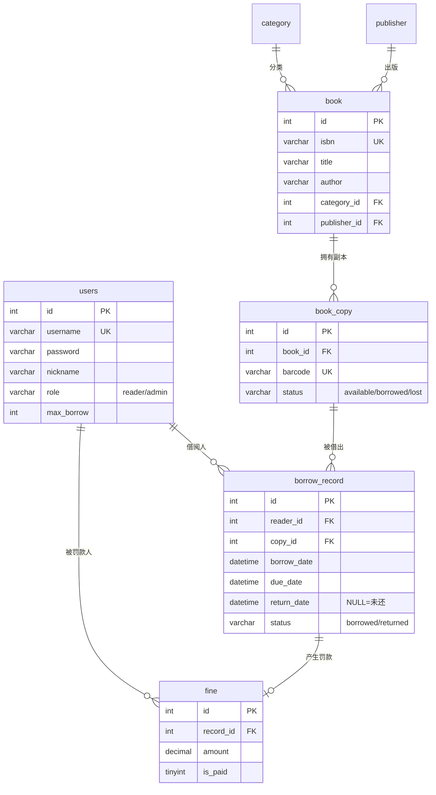

# Bookish · 数据库设计

> 项目英文名：**Bookish**
> 命名理由：与 `delicious` 同为「形容词式」命名，形成你自己的项目系列感；`bookish` 意为「爱读书的、书卷气的」，贴合图书馆主题；仓库名、域名都干净。
> 备选：`LibStack`（图书馆 + 技术栈，工程师味更重）、`Shelfwise`（书架 + 明智）。

---

## 一、业务一句话

**一个图书馆借阅管理系统。** 读者可以检索图书、借书、还书、续借、查看自己的借阅记录；管理员可以维护书目与馆藏副本、查看全馆借阅流水、看统计看板。

比 delicious 多出来的关键复杂度 —— **副本（copy）概念**：

> delicious 里「一道菜」就是可下单的对象。但图书馆里「一本书」是**书目信息**（书名/作者/出版社），而真正能借出去的是**馆藏副本**（同一本书买了 4 本，就有 4 个条码）。所以借阅记录关联的是**副本**，不是书。
> 这一层拆分会让你的 JOIN 多一层，也是面试里很好讲的「建模取舍」。

## 二、角色

| 角色 | role 值 | 能做什么 |
|---|---|---|
| 读者 | `reader` | 检索、借书、还书、续借、看自己的借阅记录 |
| 管理员 | `admin` | 上述全部 + 图书/副本维护 + 全馆借阅流水 + 统计看板 |

---

## 三、表关系总览



**一句话记住关联链**：

```
users ──< borrow_record >── book_copy ──< book >── category
                                              └──> publisher
```

---

## 四、建表 DDL（可直接执行）

> 建议：**加外键**。虽然它会限制你的删除顺序，但这是「防止产生脏数据」的正确做法，也是面试加分项。
> 库名：`bookish_db`（字符集务必 `utf8mb4`）

```sql
CREATE DATABASE IF NOT EXISTS bookish_db
  DEFAULT CHARACTER SET utf8mb4 COLLATE utf8mb4_general_ci;
USE bookish_db;
```

### 4.1 用户表 users

```sql
DROP TABLE IF EXISTS fine;
DROP TABLE IF EXISTS borrow_record;
DROP TABLE IF EXISTS book_copy;
DROP TABLE IF EXISTS book;
DROP TABLE IF EXISTS publisher;
DROP TABLE IF EXISTS category;
DROP TABLE IF EXISTS users;

CREATE TABLE users (
  id          INT PRIMARY KEY AUTO_INCREMENT,
  username    VARCHAR(50)  NOT NULL              COMMENT '登录账号',
  password    VARCHAR(100) NOT NULL              COMMENT '密码（学习项目明文，生产必须加盐哈希）',
  nickname    VARCHAR(50)  NOT NULL              COMMENT '姓名/昵称',
  phone       VARCHAR(20)           DEFAULT NULL COMMENT '手机号',
  role        VARCHAR(20)  NOT NULL DEFAULT 'reader' COMMENT 'reader=读者, admin=管理员',
  max_borrow  INT          NOT NULL DEFAULT 5    COMMENT '最多可同时借几本',
  create_time DATETIME     NOT NULL DEFAULT CURRENT_TIMESTAMP,
  UNIQUE KEY uk_username (username)
) ENGINE=InnoDB DEFAULT CHARSET=utf8mb4 COMMENT='用户表（读者+管理员）';
```

> `max_borrow` 这个字段不是摆设 —— 借书接口要校验「我当前在借数量 < max_borrow」，这会逼你写一条 `COUNT` 查询，正好用上后面的联合索引。

### 4.2 分类表 category

```sql
CREATE TABLE category (
  id      INT PRIMARY KEY AUTO_INCREMENT,
  name    VARCHAR(50) NOT NULL COMMENT '分类名',
  sort_no INT NOT NULL DEFAULT 0 COMMENT '排序号，越小越靠前',
  UNIQUE KEY uk_name (name)
) ENGINE=InnoDB DEFAULT CHARSET=utf8mb4 COMMENT='图书分类';
```

### 4.3 出版社表 publisher

```sql
CREATE TABLE publisher (
  id      INT PRIMARY KEY AUTO_INCREMENT,
  name    VARCHAR(100) NOT NULL COMMENT '出版社名称',
  address VARCHAR(200) DEFAULT NULL,
  phone   VARCHAR(20)  DEFAULT NULL,
  UNIQUE KEY uk_name (name)
) ENGINE=InnoDB DEFAULT CHARSET=utf8mb4 COMMENT='出版社';
```

### 4.4 图书表 book（书目信息，不是可借对象）

```sql
CREATE TABLE book (
  id           INT PRIMARY KEY AUTO_INCREMENT,
  isbn         VARCHAR(20)   NOT NULL COMMENT 'ISBN 号',
  title        VARCHAR(200)  NOT NULL COMMENT '书名',
  author       VARCHAR(100)  NOT NULL COMMENT '作者',
  category_id  INT           NOT NULL COMMENT '分类 id',
  publisher_id INT           NOT NULL COMMENT '出版社 id',
  price        DECIMAL(10,2) NOT NULL DEFAULT 0.00,
  publish_date DATE          DEFAULT NULL,
  intro        VARCHAR(500)  DEFAULT NULL COMMENT '简介',
  cover        VARCHAR(200)  DEFAULT NULL COMMENT '封面图路径，如 image/1.jpg',
  create_time  DATETIME      NOT NULL DEFAULT CURRENT_TIMESTAMP,
  UNIQUE KEY uk_isbn (isbn),
  KEY idx_category  (category_id),
  KEY idx_publisher (publisher_id),
  KEY idx_title     (title),
  CONSTRAINT fk_book_category  FOREIGN KEY (category_id)  REFERENCES category(id),
  CONSTRAINT fk_book_publisher FOREIGN KEY (publisher_id) REFERENCES publisher(id)
) ENGINE=InnoDB DEFAULT CHARSET=utf8mb4 COMMENT='图书书目信息';
```

### 4.5 馆藏副本表 book_copy ★本项目新增的关键表

```sql
CREATE TABLE book_copy (
  id       INT PRIMARY KEY AUTO_INCREMENT,
  book_id  INT         NOT NULL COMMENT '属于哪本书',
  barcode  VARCHAR(30) NOT NULL COMMENT '条码号（扫码借书用，全馆唯一）',
  status   VARCHAR(20) NOT NULL DEFAULT 'available' COMMENT 'available=在架, borrowed=借出, lost=遗失',
  location VARCHAR(50) DEFAULT NULL COMMENT '书架位置，如 A区-3-2',
  UNIQUE KEY uk_barcode (barcode),
  KEY idx_book_status (book_id, status),
  CONSTRAINT fk_copy_book FOREIGN KEY (book_id) REFERENCES book(id)
) ENGINE=InnoDB DEFAULT CHARSET=utf8mb4 COMMENT='馆藏副本（一本实体书）';
```

> **`idx_book_status (book_id, status)` 是你的第一个联合索引练习点**：
> 「查某本书还有几本可借」= `WHERE book_id=? AND status='available'` → 完美命中。
> 如果只建 `idx_book`，它也能用，但要多回表过滤 status。对比一下 `EXPLAIN`。

### 4.6 借阅记录表 borrow_record ★核心表

```sql
CREATE TABLE borrow_record (
  id          INT PRIMARY KEY AUTO_INCREMENT,
  reader_id   INT      NOT NULL COMMENT '借阅人',
  copy_id     INT      NOT NULL COMMENT '借的哪个副本',
  borrow_date DATETIME NOT NULL DEFAULT CURRENT_TIMESTAMP COMMENT '借出时间',
  due_date    DATETIME NOT NULL COMMENT '应归还时间',
  return_date DATETIME DEFAULT NULL COMMENT '实际归还时间，NULL 表示还没还',
  status      VARCHAR(20) NOT NULL DEFAULT 'borrowed' COMMENT 'borrowed=在借, returned=已还',
  renew_count INT      NOT NULL DEFAULT 0 COMMENT '已续借次数',
  KEY idx_reader_status (reader_id, status),
  KEY idx_copy_return   (copy_id, return_date),
  KEY idx_due           (due_date),
  KEY idx_borrow_date   (borrow_date),
  CONSTRAINT fk_br_reader FOREIGN KEY (reader_id) REFERENCES users(id),
  CONSTRAINT fk_br_copy   FOREIGN KEY (copy_id)   REFERENCES book_copy(id)
) ENGINE=InnoDB DEFAULT CHARSET=utf8mb4 COMMENT='借阅记录';
```

> **「逾期」不存字段，靠算**：`return_date IS NULL AND due_date < NOW()` 就是逾期。
> 不要加一个 `overdue` 状态 —— 因为「是否逾期」随时间自动变化，存成字段就必须靠定时任务去刷，这类字段叫「派生数据」，能不存就不存。**这一点面试官很爱问。**

### 4.7 罚款表 fine

```sql
CREATE TABLE fine (
  id          INT PRIMARY KEY AUTO_INCREMENT,
  record_id   INT           NOT NULL COMMENT '对应的借阅记录',
  reader_id   INT           NOT NULL COMMENT '被罚读者',
  amount      DECIMAL(10,2) NOT NULL COMMENT '金额（元）',
  reason      VARCHAR(200)  DEFAULT NULL COMMENT '罚款原因',
  is_paid     TINYINT       NOT NULL DEFAULT 0 COMMENT '0=未缴, 1=已缴',
  create_time DATETIME      NOT NULL DEFAULT CURRENT_TIMESTAMP,
  KEY idx_reader (reader_id),
  KEY idx_record (record_id),
  KEY idx_unpaid (is_paid),
  CONSTRAINT fk_fine_record FOREIGN KEY (record_id) REFERENCES borrow_record(id),
  CONSTRAINT fk_fine_reader FOREIGN KEY (reader_id) REFERENCES users(id)
) ENGINE=InnoDB DEFAULT CHARSET=utf8mb4 COMMENT='罚款记录';
```

---

## 五、索引设计一览（重点）

| 表 | 索引 | 服务什么查询 | 类型 |
|---|---|---|---|
| users | `uk_username` | 登录、注册查重 | 唯一 |
| category | `uk_name` | 分类名查重 | 唯一 |
| publisher | `uk_name` | 出版社名查重 | 唯一 |
| book | `uk_isbn` | ISBN 查重 | 唯一 |
| book | `idx_category` | 「只看计算机类」 | 普通 |
| book | `idx_publisher` | 「只看某出版社」 | 普通 |
| book | `idx_title` | 书名搜索 | 普通 |
| book_copy | `uk_barcode` | 扫码借书 | 唯一 |
| book_copy | `idx_book_status` | **「这本书还有几本可借」** | **联合** |
| borrow_record | `idx_reader_status` | **「我的在借书籍」** | **联合** |
| borrow_record | `idx_copy_return` | 「这个副本现在还借出去没有」 | **联合** |
| borrow_record | `idx_due` | 逾期扫描 | 普通 |
| borrow_record | `idx_borrow_date` | 按时间统计 | 普通 |
| fine | `idx_reader` / `idx_record` / `idx_unpaid` | 罚款查询 | 普通 |

### 三条要记住的规则

1. **外键列会自动需要索引**：MySQL 建立 `FOREIGN KEY` 时，如果列上没有索引会自动创建。所以我用了 `idx_reader_status (reader_id, status)` 后，就不用再单独给 `reader_id` 建索引 —— 因为**最左前缀 `reader_id` 已经满足外键要求**。
2. **联合索引的顺序决定它能服务哪些查询**：`(reader_id, status)` 能服务 `WHERE reader_id=?`、`WHERE reader_id=? AND status=?`，但**不能**服务 `WHERE status=?`（违反最左前缀）。
3. **索引不是越多越好**：每个索引都会拖慢 `INSERT/UPDATE/DELETE`。这张表已经 4 个索引，再加就过了。

---

## 六、种子数据

### 6.1 用户（10 个读者 + 1 个管理员，密码统一 123456）

```sql
INSERT INTO users (username, password, nickname, phone, role, max_borrow) VALUES
('admin',    '123456', '图书馆管理员', '13800000000', 'admin',  99),
('zhangsan', '123456', '张三',        '13800000001', 'reader', 5),
('lisi',     '123456', '李四',        '13800000002', 'reader', 5),
('wangwu',   '123456', '王五',        '13800000003', 'reader', 5),
('zhaoliu',  '123456', '赵六',        '13800000004', 'reader', 5),
('sunqi',    '123456', '孙七',        '13800000005', 'reader', 3),
('zhouba',   '123456', '周八',        '13800000006', 'reader', 5),
('wujiu',    '123456', '吴九',        '13800000007', 'reader', 5),
('zhengshi', '123456', '郑十',        '13800000008', 'reader', 5),
('qianyi',   '123456', '钱一',        '13800000009', 'reader', 5),
('suner',    '123456', '孙二',        '13800000010', 'reader', 5);
```

> ⚠️ `admin` 的 `id` 一定是 **1**（因为它是第一条）。读者的 id 是 2~11。后面的造数据脚本依赖这个。

### 6.2 分类（8 条）

```sql
INSERT INTO category (name, sort_no) VALUES
('计算机',   1),
('文学小说', 2),
('历史',     3),
('经济管理', 4),
('科普',     5),
('心理学',   6),
('外语学习', 7),
('艺术设计', 8);
```

### 6.3 出版社（8 条）

```sql
INSERT INTO publisher (name, address, phone) VALUES
('人民邮电出版社', '北京市丰台区', '010-81055000'),
('机械工业出版社', '北京市西城区', '010-88379000'),
('清华大学出版社', '北京市海淀区', '010-62770175'),
('电子工业出版社', '北京市海淀区', '010-88254888'),
('中信出版社',     '北京市朝阳区', '010-84849555'),
('人民文学出版社', '北京市朝阳区', '010-65252043'),
('商务印书馆',     '北京市东城区', '010-65219593'),
('译林出版社',     '江苏省南京市', '025-83213038');
```

### 6.4 图书（40 本）

```sql
INSERT INTO book (isbn, title, author, category_id, publisher_id, price, publish_date, intro) VALUES
('9787115428028', 'Java核心技术 卷I',      'Cay S. Horstmann', 1, 1, 149.00, '2016-09-01', 'Java 领域经典入门与进阶读物，覆盖语言基础与标准库。'),
('9787111213826', 'Effective Java',        'Joshua Bloch',     1, 2, 99.00,  '2018-01-01', 'Java 编程最佳实践，含 90 条经验法则。'),
('9787111544937', '深入理解Java虚拟机',    '周志明',           1, 2, 129.00, '2019-12-01', 'JVM 领域公认的经典，讲内存模型与垃圾回收。'),
('9787115546081', '图解HTTP',              '上野宣',           1, 1, 69.00,  '2021-03-01', '用图解方式讲清 HTTP 协议基础与实战。'),
('9787115275790', 'JavaScript高级程序设计','Matt Frisbie',     1, 1, 129.00, '2020-11-01', '前端人员的 JS 红宝书。'),
('9787121353376', 'MySQL技术内幕',         '姜承尧',           1, 4, 89.00,  '2019-02-01', 'InnoDB 存储引擎原理与实现，索引部分必读。'),
('9787111606987', '高性能MySQL',           'Baron Schwartz',   1, 2, 139.00, '2019-06-01', 'MySQL 性能优化与索引设计的权威之作。'),
('9787121313216', 'Redis设计与实现',       '黄健宏',           1, 4, 79.00,  '2018-05-01', 'Redis 内部数据结构与实现原理。'),
('9787115472034', '代码整洁之道',          'Robert C. Martin', 1, 1, 59.00,  '2020-01-01', '如何写出可读、可维护的代码。'),
('9787111558422', '重构 改善既有代码的设计','Martin Fowler',    1, 2, 118.00, '2019-03-01', '重构手法的系统性总结。'),
('9787020002207', '红楼梦',                '曹雪芹',           2, 6, 59.70,  '1996-12-01', '中国古典小说四大名著之一。'),
('9787020008735', '西游记',                '吴承恩',           2, 6, 47.20,  '2010-01-01', '中国古典神魔小说代表作。'),
('9787532776870', '活着',                  '余华',             2, 5, 45.00,  '2012-08-01', '讲述一个人一生的苦难与坚韧。'),
('9787506365437', '许三观卖血记',          '余华',             2, 5, 39.00,  '2012-08-01', '以卖血为线索的平民史诗。'),
('9787544253994', '百年孤独',              '加西亚·马尔克斯',  2, 8, 55.00,  '2011-06-01', '魔幻现实主义文学的代表作。'),
('9787532758982', '小王子',                '圣埃克苏佩里',     2, 8, 32.00,  '2011-01-01', '写给大人的童话。'),
('9787020104345', '围城',                  '钱锺书',           2, 6, 39.00,  '2017-06-01', '中国现代文学讽刺小说经典。'),
('9787532779338', '挪威的森林',            '村上春树',         2, 8, 52.00,  '2018-04-01', '青春与孤独的代言作。'),
('9787100132551', '万历十五年',            '黄仁宇',           3, 7, 45.00,  '2017-01-01', '以大历史观剖析明代政治。'),
('9787521703412', '人类简史',              '尤瓦尔·赫拉利',    3, 5, 68.00,  '2017-02-01', '从认知革命讲到科学革命。'),
('9787508660752', '枪炮、病菌与钢铁',      '贾雷德·戴蒙德',    3, 5, 78.00,  '2016-10-01', '地理与文明演化的宏大叙事。'),
('9787108063109', '中国历代政治得失',      '钱穆',             3, 7, 38.00,  '2018-09-01', '简要梳理汉唐宋明清五朝制度。'),
('9787521706048', '枪炮与玫瑰',            '未知',             3, 5, 42.00,  '2019-05-01', '近现代史专题随笔集。'),
('9787508684031', '原则',                  '瑞·达利欧',        4, 5, 98.00,  '2018-01-01', '桥水基金创始人的工作与生活原则。'),
('9787521708554', '穷查理宝典',            '查理·芒格',        4, 5, 88.00,  '2019-01-01', '多元思维模型的集大成之作。'),
('9787115473246', '经济学原理',            '曼昆',             4, 2, 128.00, '2020-06-01', '经济学入门教材，十大原理开篇。'),
('9787508647357', '思考，快与慢',           '丹尼尔·卡尼曼',    6, 5, 69.00,  '2012-07-01', '系统一与系统二的思维框架。'),
('9787521701555', '影响力',                '罗伯特·西奥迪尼',  6, 5, 58.00,  '2019-01-01', '六大说服原理。'),
('9787115474993', '乌合之众',              '古斯塔夫·勒庞',    6, 1, 36.00,  '2018-06-01', '群体心理学的开山之作。'),
('9787544785047', '被讨厌的勇气',          '岸见一郎',         6, 8, 45.00,  '2015-03-01', '阿德勒心理学的对话体入门。'),
('9787535795106', '时间简史',              '史蒂芬·霍金',      5, 5, 55.00,  '2010-04-01', '从大爆炸讲到黑洞。'),
('9787535790795', '上帝掷骰子吗',          '曹天元',           5, 5, 62.00,  '2013-01-01', '量子物理史话。'),
('9787521703372', '宇宙的琴弦',            '布莱恩·格林',      5, 5, 66.00,  '2018-08-01', '弦理论的通俗讲解。'),
('9787115373991', '数学之美',              '吴军',             5, 1, 59.00,  '2014-11-01', '用信息论串起自然语言处理。'),
('9787513590669', '新概念英语',            '亚历山大',         7, 7, 45.00,  '2019-01-01', '经典英语学习教材。'),
('9787513590676', '英语语法新思维',        '张满胜',           7, 7, 52.00,  '2020-05-01', '从思维角度讲英语语法。'),
('9787550285062', '写给大家看的设计书',    'Robin Williams',   8, 1, 69.00,  '2016-04-01', '设计四大原则：亲密、对齐、重复、对比。'),
('9787121352898', '色彩设计的原理',        '奥博斯科',         8, 4, 78.00,  '2019-08-01', '配色方案与视觉心理。'),
('9787544291170', '艺术的故事',            '贡布里希',         8, 8, 168.00, '2017-11-01', '西方艺术史入门经典。'),
('9787559639163', '设计师要懂心理学',      'Susan Weinschenk', 8, 1, 59.00,  '2018-09-01', '100 条设计心理学法则。');
```

### 6.5 馆藏副本（每本 4 个副本，共 160 个）

```sql
-- 用脚本批量生成，比手写 160 条快
DROP PROCEDURE IF EXISTS gen_copy;
DELIMITER $$
CREATE PROCEDURE gen_copy()
BEGIN
  DECLARE b INT DEFAULT 1;      -- 书 id
  DECLARE n INT;                -- 副本序号
  DECLARE max_b INT;
  SELECT MAX(id) INTO max_b FROM book;
  WHILE b <= max_b DO
    SET n = 1;
    WHILE n <= 4 DO
      INSERT INTO book_copy (book_id, barcode, status, location)
      VALUES (b, CONCAT('BC', LPAD(b, 4, '0'), LPAD(n, 2, '0')),
              'available',
              CONCAT(CHAR(65 + (b % 6)), '区-', (n + b) % 20, '-', b % 8));
      SET n = n + 1;
    END WHILE;
    SET b = b + 1;
  END WHILE;
END$$
DELIMITER ;
CALL gen_copy();
-- 预期结果：160 行，条码形如 BC000101
```

---

## 七、⭐ 造压测数据（做索引实验的前提）

**必须有几千行数据，索引实验才有意义。** 单表 40 行的表，加不加索引 MySQL 都秒查，你根本看不出差别。

```sql
DROP PROCEDURE IF EXISTS gen_borrow;
DELIMITER $$
CREATE PROCEDURE gen_borrow(IN total INT)
BEGIN
  DECLARE i INT DEFAULT 0;
  DECLARE rd INT;      -- reader_id
  DECLARE cp INT;      -- copy_id
  DECLARE bd DATETIME; -- borrow_date
  DECLARE dd DATETIME; -- due_date
  DECLARE rtn DATETIME;-- return_date
  DECLARE st VARCHAR(20);
  DECLARE max_u INT;
  DECLARE max_c INT;
  SELECT MAX(id) INTO max_u FROM users;
  SELECT MAX(id) INTO max_c FROM book_copy;

  WHILE i < total DO
    SET rd = 2 + FLOOR(RAND() * (max_u - 1));   -- 只在读者里选（跳过 admin）
    SET cp = 1 + FLOOR(RAND() * max_c);
    SET bd = DATE_SUB(NOW(), INTERVAL FLOOR(RAND() * 365) DAY);
    SET dd = DATE_ADD(bd, INTERVAL 30 DAY);
    IF RAND() < 0.65 THEN
      SET rtn = DATE_ADD(bd, INTERVAL FLOOR(1 + RAND() * 40) DAY);
      SET st  = 'returned';
    ELSE
      SET rtn = NULL;
      SET st  = 'borrowed';
    END IF;
    INSERT INTO borrow_record (reader_id, copy_id, borrow_date, due_date, return_date, status)
    VALUES (rd, cp, bd, dd, rtn, st);
    SET i = i + 1;
  END WHILE;
END$$
DELIMITER ;

CALL gen_borrow(5000);
-- 执行完删掉存储过程
DROP PROCEDURE IF EXISTS gen_borrow;
DROP PROCEDURE IF EXISTS gen_copy;
```

> ⚠️ **这批数据是刻意造的压测数据，不满足业务唯一性** —— 同一个副本可能被多个人同时「在借」。
> 真实业务里这不可能发生，靠的是借书接口的 `@Transactional` + 副本状态校验。压测数据只关心「行数够多」，别用它去验证业务逻辑。

**验证数据量**：

```sql
SELECT COUNT(*) FROM borrow_record;   -- 应该是 5000
SELECT status, COUNT(*) FROM borrow_record GROUP BY status;
-- borrowed 约 1750，returned 约 3250
```

---

## 八、⭐⭐ 索引实验任务（本项目的核心目的）

> 每个实验：先 `EXPLAIN` 看加索引前 → 加索引 → 再看一次 → 记下 `type` / `rows` / `key` / `Extra` 四列的变化。
> 建议把每次对比结果记成一个表格，这就是你面试时能讲的东西。

### 实验 1 · 联合索引到底有没有生效

```sql
-- 第 1 步：先把索引删掉，模拟"没建索引"的情况
ALTER TABLE borrow_record DROP INDEX idx_reader_status;

EXPLAIN SELECT * FROM borrow_record WHERE reader_id = 5 AND status = 'borrowed';
-- 预期：type=ALL，rows≈5000，key=NULL  ← 全表扫描

-- 第 2 步：加回来
ALTER TABLE borrow_record ADD INDEX idx_reader_status (reader_id, status);

EXPLAIN SELECT * FROM borrow_record WHERE reader_id = 5 AND status = 'borrowed';
-- 预期：type=ref，rows≈几十，key=idx_reader_status  ← 命中索引
```

**要能回答**：为什么 `rows` 从 5000 降到几十，查询就快了？（减少了扫描行数 → 减少了磁盘 IO）

### 实验 2 · 最左前缀原则（面试超高频）

```sql
-- 用不上索引
EXPLAIN SELECT * FROM borrow_record WHERE status = 'borrowed';
-- 预期：type=ALL，key=NULL   ← 因为跳过了最左列 reader_id

-- 用得上
EXPLAIN SELECT * FROM borrow_record WHERE reader_id = 5;
-- 预期：type=ref，key=idx_reader_status

-- 用得上（两个都用）
EXPLAIN SELECT * FROM borrow_record WHERE reader_id = 5 AND status = 'borrowed';
```

**要能回答**：`(reader_id, status)` 为什么不能服务「只按 status 查」？（因为 B+ 树是先按 reader_id 排序的，不知道 reader_id 就无法定位）

> 📌 顺带想一个问题：如果业务里「按 status 单独查」也很频繁，你该怎么办？→ 要么单独建 `idx_status`，要么把 `status` 放到联合索引第一位（但那样 `WHERE reader_id=?` 就废了）。**这叫「索引顺序是取舍，不是对错」。**

### 实验 3 · 覆盖索引（Extra: Using index）

```sql
-- 回表：查了 *，需要回到主键索引取其他列
EXPLAIN SELECT * FROM borrow_record WHERE reader_id = 5;
-- 预期：Extra = NULL（要回表）

-- 覆盖索引：查的列全在索引里，不用回表
EXPLAIN SELECT id, reader_id, status FROM borrow_record WHERE reader_id = 5;
-- 预期：Extra = Using index  ← 关键标志
```

**要能回答**：什么是回表？为什么覆盖索引快？（二级索引叶子节点只有索引列 + 主键，拿到主键后还要去主键索引再查一次 → 多一次 IO）

### 实验 4 · 深分页问题（真实项目必踩）

```sql
-- 浅分页：快
SELECT * FROM borrow_record ORDER BY id LIMIT 10;
-- 预期：毫秒级

-- 深分页：慢
SELECT * FROM borrow_record ORDER BY id LIMIT 4990, 10;
-- 预期：明显变慢（MySQL 要先扫描并丢弃前 4990 行）

-- 优化：用「游标」代替 offset
SELECT * FROM borrow_record WHERE id > 4990 ORDER BY id LIMIT 10;
-- 预期：又变快（主键索引直接定位）
```

**要能回答**：`LIMIT 4990, 10` 为什么慢？（不是只读 10 行，是读了 5000 行再扔掉前 4990 行）

### 实验 5 · LIKE 什么情况下走索引

```sql
EXPLAIN SELECT * FROM book WHERE title LIKE 'Java%';    -- 预期：key=idx_title（前缀匹配可用）
EXPLAIN SELECT * FROM book WHERE title LIKE '%Java%';   -- 预期：key=NULL（以通配符开头，无法定位）
EXPLAIN SELECT * FROM book WHERE title LIKE '%Java';    -- 预期：key=NULL
```

**要能回答**：为什么 `%xx` 不走索引？（B+ 树是按字符顺序排的，不知道开头就没法二分定位）
→ 延伸：真实项目里「书名搜索」怎么做？→ **全文索引 / Elasticsearch / 前缀 + 分词**，这也是面试常问的后续。

### 实验 6 · 六表 JOIN 的驱动表是谁

这是你**写完接口后**做的实验：

```sql
EXPLAIN
SELECT br.id, u.nickname AS reader_name, b.title, c.name AS category_name,
       p.name AS publisher_name, br.borrow_date, br.due_date, br.status
FROM borrow_record br
JOIN users      u ON br.reader_id  = u.id
JOIN book_copy bc ON br.copy_id    = bc.id
JOIN book       b ON bc.book_id    = b.id
JOIN category   c ON b.category_id = c.id
JOIN publisher  p ON b.publisher_id= p.id
WHERE br.reader_id = 5
ORDER BY br.id DESC
LIMIT 10;
```

**要能回答**：
- `EXPLAIN` 输出**第一行就是驱动表**，后面是被驱动表。这里的驱动表应该是谁？
- 为什么把 `WHERE br.reader_id = 5` 写在 `borrow_record` 上很关键？（缩小驱动表 → 后面的 JOIN 都变少）

---

## 九、多表联查任务清单（由易到难）

做完这些，你的 JOIN 就真的熟了。

| # | 难度 | 需求 | 涉及表 | 关键语法 |
|---|---|---|---|---|
| 1 | ★ | 查所有图书，带分类名和出版社名 | book + category + publisher | 两个 `LEFT JOIN` + **别名** |
| 2 | ★ | 查某本书的所有副本及状态 | book_copy | 单表 |
| 3 | ★★ | 查「有在架副本的图书」列表 | book + book_copy | `JOIN` + `GROUP BY` + `HAVING` |
| 4 | ★★ | 查我的借阅记录（含书名、分类、条码） | borrow_record + book_copy + book + category | 四表 JOIN |
| 5 | ★★ | 查我的逾期未还记录 | 同上 + `return_date IS NULL` | 日期比较 |
| 6 | ★★★ | 全馆借阅流水（含读者名、书名、分类、出版社） | **六表** | 五连 JOIN |
| 7 | ★★★ | 借阅次数 TOP10 图书 | borrow_record + book | `GROUP BY` + `COUNT` + `ORDER BY` + `LIMIT` |
| 8 | ★★★ | 各分类的借阅量统计 | +3 表到 category | 多级 `GROUP BY` |
| 9 | ★★★ | 每月借出量趋势 | borrow_record | `DATE_FORMAT(borrow_date,'%Y-%m')` + `GROUP BY` |
| 10 | ★★★★ | 每个读者「当前借了几本 / 上限几本」（含一个没借过书的读者） | users + borrow_record | **`LEFT JOIN` 而非 `JOIN`**（差一个字，结果差一批人） |
| 11 | ★★★★ | 找出「从没被借过的图书」 | book + book_copy + borrow_record | `LEFT JOIN ... WHERE ... IS NULL` |
| 12 | ★★★★ | 借阅最多的读者 TOP5（含罚款总额） | users + borrow_record + fine | 两路聚合后合并，小心**笛卡尔积放大** |

> 第 10、11、12 题是**最容易写错的三类**：`LEFT JOIN` 和 `JOIN` 的选择、`IS NULL` 反查、多表聚合的笛卡尔积放大。写完把 SQL 发我，我给你逐句看。

---

## 十、建表后立刻自检

```sql
-- 1. 表都在吗
SHOW TABLES;
-- 2. 索引建对了吗（重点看 borrow_record）
SHOW INDEX FROM borrow_record;
-- 3. 外键都在吗
SELECT TABLE_NAME, COLUMN_NAME, CONSTRAINT_NAME, REFERENCED_TABLE_NAME
FROM information_schema.KEY_COLUMN_USAGE
WHERE TABLE_SCHEMA = 'bookish_db' AND REFERENCED_TABLE_NAME IS NOT NULL;
-- 4. 数据量
SELECT (SELECT COUNT(*) FROM book) AS books,
       (SELECT COUNT(*) FROM book_copy) AS copies,
       (SELECT COUNT(*) FROM borrow_record) AS records;
```
